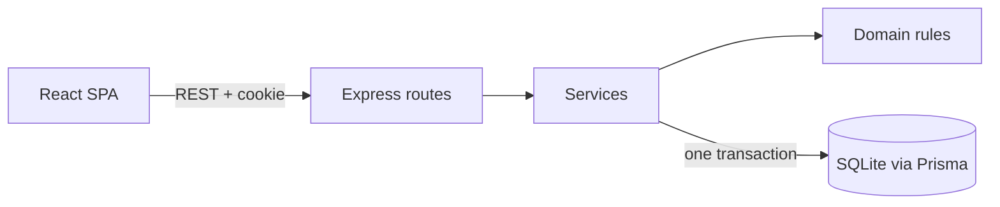
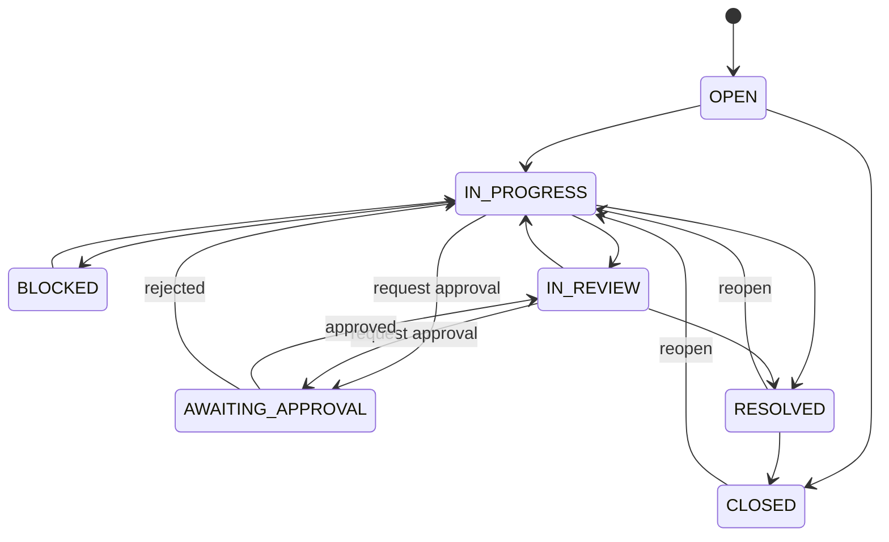
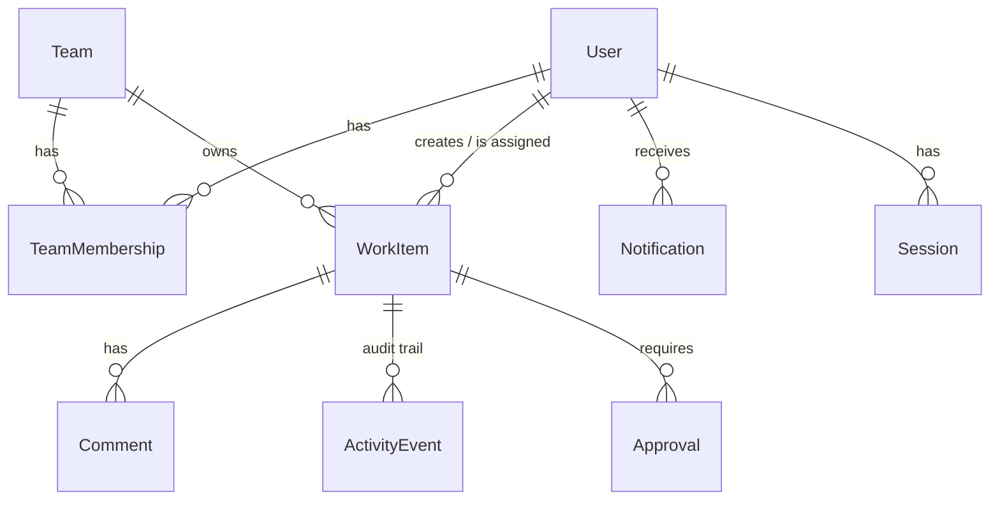

<div align="center">

# Newtonite Ops

**Every request accounted for. Every action traceable.**

An internal operations work-management platform: create work, assign owners, enforce a workflow,
approve decisions, collaborate, and keep a trustworthy audit trail, even when many people act at once.

[](https://github.com/PriyanshuCoder07/newtonite-ops/actions/workflows/ci.yml)


Built for the **Newtonite Software Engineering Challenge: "Operations Under Pressure"**

[Quick start](#-quick-start) · [Demo accounts](#-demo-accounts) · [Architecture](#-architecture) · [Engineering decisions](./ENGINEERING_DECISIONS.md) · [Limitations](#-known-limitations)

</div>

---

## 🎯 Why this exists

Operational work at a growing company lives in chat threads, spreadsheets and email. Requests get lost,
two people fix the same thing, someone edits a request that someone else just changed, and nobody can
say who decided what or why. Newtonite Ops replaces that with one workspace where every item has an
owner, a status, a priority and a history, and where **concurrent use is handled deliberately** instead
of hoping users behave.

## ✨ Highlights

| Capability | How it works |
|---|---|
| **Stale-write protection** | Every item carries a `version`. Edits are one atomic `UPDATE ... WHERE id AND version`; a stale client gets **409** with the current version, never a silent overwrite. |
| **Race-safe assignment and approvals** | Of N simultaneous requests exactly one wins and the rest get 409. Tested with real parallel requests. |
| **Enforced workflow** | A backend transition table. Approval-gated work types cannot be resolved without an approved request, and a plain status `PATCH` cannot bypass it. |
| **Team-scoped authorization** | Per-team roles (Manager / Member / Viewer) plus a platform Admin. Other teams' items return **404**, so existence isn't leaked. |
| **Transactional audit trail** | State change, audit event and notification are written in one transaction. If any part fails, all of it rolls back. |
| **Duplicate-operation handling** | Repeated approval decisions return 409, no-op edits don't bump versions or log events, and creates accept an `Idempotency-Key`. |
| **Built to stay fast** | Server-side search, filters, sorting and pagination; permission-scoped queries; database indexes on the filtered columns. |

## 🧩 Features

- **Work items**: create, view, edit, assign and reassign, resolve, close and reopen, with readable references (`OPS-1001`).
- **Six work types** (customer issue, engineering problem, payment investigation, production incident, compliance request, operational task), **seven statuses**, **four priorities**.
- **Approvals**: request, list, approve or reject, tied to the item's state in the same transaction.
- **Collaboration**: comments plus an append-only activity timeline with *who*, *what* and *when* (server-generated).
- **Dashboard**: counts computed from the database (active, mine, critical/high, blocked, awaiting approval, overdue, unassigned, stale) with links into filtered lists.
- **Search and filters** that combine: text, status, priority, type, team, assignee, creator, dates, overdue, unassigned. Six sort orders.
- **Notifications**: in-app, created transactionally (assigned, reassigned, approval requested, approval decided, critical item blocked).
- **Auth**: cookie sessions with hashed tokens, bcrypt passwords, login rate limiting.

## 🛠 Tech stack

| Layer | Technology |
|---|---|
| Frontend | React 19, TypeScript, Vite 6, Tailwind CSS 3, React Router 7, TanStack Query 5, React Hook Form, Zod, Lucide |
| Backend | Node.js, Express 4, TypeScript, Zod, Prisma 6 |
| Database | SQLite (see [limitations](#-known-limitations): the brief suggested PostgreSQL) |
| Testing | Vitest, Supertest, React Testing Library |
| CI | GitHub Actions: typecheck, build and all tests on every push |

## 🏗 Architecture



The **domain rules** are pure functions in `permissions.ts` and `workflow.ts`. The **one transaction** holds
the item change, its audit event and any notification.

Every mutation follows the same path: authenticate, validate, load the resource through a team-scoped
check, apply the workflow rule, then run **one transaction** containing the conditional update, the
audit event and any notification.

### Workflow



Payment investigations, compliance requests and production incidents can only be resolved when their
latest approval is **APPROVED**.

### Data model



Also: `IdempotencyKey` (replay of successful requests) and `Counter` (reference numbers).
History uses `Restrict` foreign keys, and users and teams are deactivated, never deleted, so the audit
trail stays meaningful.

### Permissions

| Action | Manager | Member | Viewer |
|---|:---:|:---:|:---:|
| Read items, comments, history | ✅ | ✅ | ✅ |
| Create item, comment | ✅ | ✅ | ❌ |
| Edit fields | ✅ | assigned items only | ❌ |
| Assign / reassign | ✅ | ❌ | ❌ |
| Status transitions | ✅ | if assignee or unassigned | ❌ |
| Close / reopen | ✅ | ❌ | ❌ |
| Request approval | ✅ | if assignee | ❌ |
| Decide approval | ✅ (not own request) | ❌ | ❌ |

Platform **Admin** can do everything. All checks run in the backend service layer; the UI hiding a
button is a convenience only.

## 🚀 Quick start

**Prerequisites:** Node.js 20+ (developed on 22) and npm. No Docker needed.

```bash
git clone https://github.com/PriyanshuCoder07/newtonite-ops.git
cd newtonite-ops

npm install                      # also runs `prisma generate` (postinstall)
cp .env.example server/.env      # Windows PowerShell: copy .env.example server\.env
npm run db:migrate:deploy        # creates server/prisma/dev.db from the versioned migration
npm run db:seed                  # demo data (this DELETES existing data in that database)
npm run dev                      # API on :3001, web app on :5173
```

Open **http://localhost:5173**. Health check: `GET http://localhost:3001/api/health`.

> If you see `@prisma/client did not initialize yet`, run `npm run db:generate` once and retry.

| Command | What it does |
|---|---|
| `npm run dev` | API and web app together |
| `npm test` | server and client tests |
| `npm run typecheck` | server typecheck plus client production build |
| `npm run build` | compile server and client |
| `npm run db:reset` | re-apply migrations and re-seed |

### Environment variables

`DATABASE_URL`, `PORT`, `NODE_ENV`, `CLIENT_ORIGIN` (CORS), `SESSION_SECRET`, `SESSION_COOKIE_NAME`,
`SESSION_TTL_HOURS`, `STALE_AFTER_HOURS` (dashboard "not updated recently" threshold). See
[`.env.example`](./.env.example). Never commit a real `.env`.

## 👤 Demo accounts

All passwords: **`Password123!`**

| Email | Role |
|---|---|
| `admin@newtonite.local` | Platform admin |
| `priya.shah@newtonite.local` | Engineering: Manager · Finance & Compliance: Viewer |
| `alex.kim@newtonite.local` | Engineering: Member · Customer Success: Member |
| `maya.chen@newtonite.local` | Customer Success: Manager |
| `jordan.lee@newtonite.local` | Customer Success: Member |
| `casey.nguyen@newtonite.local` | Customer Success: Viewer |
| `sam.okonkwo@newtonite.local` | Finance & Compliance: Manager |
| `riley.patel@newtonite.local` | Finance & Compliance: Member |
| `inactive.user@newtonite.local` | Deactivated account |

### Try these three scenarios

1. **Stale edit.** Open the same Engineering item in two browsers (`priya.shah` and `admin`). Save an
   edit in the first, then a different edit in the second: it is rejected with a conflict message and
   offers to load the latest state. That 409 comes from the backend.
2. **Authorization and approvals.** As `riley.patel` (member), try to decide the pending Finance
   approval and be refused. As `sam.okonkwo` (manager), approve it and watch the item move to *In
   Review*. Repeat the decision and get a 409.
3. **Audit and dashboard.** Create an item, change its priority, assign it, then read the activity
   timeline and watch the dashboard counts and filtered lists change.

## 🧪 Testing

```bash
npm test                # everything
npm run test:server     # Supertest integration tests on a fresh test.db built from the real migration
npm run test:client     # React Testing Library
```

**46 tests (39 server, 7 client)**, run on every push by [GitHub Actions](https://github.com/PriyanshuCoder07/newtonite-ops/actions).

| Risk | What is tested |
|---|---|
| Silent overwrites | stale update returns 409 and leaves no audit event |
| Races | 4 *simultaneous* assignments: exactly one wins, one audit event; 2 *simultaneous* approval decisions: exactly one wins |
| Duplicates | second approval decision returns 409; reused idempotency key is refused |
| Authorization | cross-team access (IDOR) returns 404; viewers can't modify; members can't approve or reopen; cross-team assignee rejected |
| Workflow | valid and invalid transitions; approval can't be bypassed with a status change |
| Consistency | when the audit insert fails (injected DB trigger), the item change rolls back |
| Search | filters combine; priority ordering is correct across pages; filter manipulation can't reach other teams' data |
| Validation | malformed bodies and query params return 400, not 500 |
| Frontend | edit sends only changed fields with the user's *base* version; 409 shows a message and reloads server state |

## 🔌 API

```bash
# log in (cookie session)
curl -c jar -H 'Content-Type: application/json' \
  -d '{"email":"priya.shah@newtonite.local","password":"Password123!"}' \
  http://localhost:3001/api/auth/login

# search, filter, sort, paginate on the server
curl -b jar 'http://localhost:3001/api/work-items?status=BLOCKED&sort=priority_desc&page=1&pageSize=20'

# send the version you last read: a mismatch returns 409 with the current version
curl -b jar -X PATCH -H 'Content-Type: application/json' \
  -d '{"version":1,"priority":"HIGH"}' http://localhost:3001/api/work-items/<id>
```

Errors share one shape: `{ "error": { "code", "message", "details?" } }`
(400 validation · 401 not signed in · 403 forbidden · 404 not found or not visible · 409 conflict · 422 idempotency-key misuse).
Lists accept `page` and `pageSize` (default 30, max 100) and return `total` and `totalPages`.

## 📁 Project structure

```
server/
  prisma/        schema.prisma, migrations/, seed.ts
  src/
    routes/      HTTP + zod validation
    services/    business rules and transactions (workItem, approval, comment, dashboard, ...)
    domain/      permissions.ts, workflow.ts (pure functions)
    middleware/  auth, errorHandler, idempotency
  tests/         Supertest integration tests
client/
  src/pages/     Overview, Work list/detail, Approvals, Activity, Teams, Settings, Login
  src/lib/       api client, auth context
```

## 📝 Engineering decisions

The reasoning and trade-offs are in **[ENGINEERING_DECISIONS.md](./ENGINEERING_DECISIONS.md)**:
data model and architecture, authorization, concurrent updates, workflow and audit transactions, and
what was deliberately left synchronous or unbuilt.

## ⚠️ Known limitations

Honest list of what this is **not**:

- **SQLite, not PostgreSQL.** One writer at a time, and the Prisma provider is hard-coded. `docker-compose.yml` starts an unused Postgres container. Moving to Postgres means changing the provider, regenerating the migration, and making search case-insensitive.
- **Search is `LIKE '%term%'`.** Not index-assisted, so it will degrade at large scale (needs full-text search or trigram indexes). **Offset pagination** slows on very deep pages.
- **No real-time push.** An open item re-fetches every 15 seconds and on window focus.
- **Idempotency:** two identical in-flight requests with the same key can both run (state guards still make the second fail), keys are never pruned, and only item creation sends a key.
- **Approval reuse:** reopening and re-resolving an approval-gated item reuses the earlier approval.
- **Notifications are in-app only**, written synchronously in the action's transaction. No queue, outbox, retries, email or chat. The list isn't paginated.
- **Comments are append-only**: no edit or delete, by design.
- **Admin management is API create-only**: no update or deactivate endpoints for users or teams.
- Assignee eligibility is checked just before, not inside, the assignment transaction.
- CSRF protection relies on `SameSite=Lax` cookies, JSON bodies and a restricted CORS origin. There are no CSRF tokens.
- Workflow rules live in code, not configuration.
- **Not done:** load testing, Playwright end-to-end tests, and automated UI tests beyond the work-item detail page.

## ✅ Verification status

- **Automated:** all 46 tests pass locally and in CI on a clean Linux install.
- **Not automated:** the UI beyond the work-item detail page is exercised manually only. No load testing has been performed.

---

<div align="center">
Built for the Newtonite Software Engineering Challenge.
</div>
